# 🛡️ Awesome Brand Safety & Ad Placement Verifiers

  
  
  
  
  
  
  
  

> 🚀 **A curated directory of enterprise SaaS platforms and open-source tools for Brand Safety, Ad Placement Verification, Invalid Traffic (IVT/SIVT) Filtration, and Contextual Pre-Bid Intelligence.**

*Focused on Contextual Scraping 🔍, Pre-Bid Filtering ⚡, Real-Time Ad Fraud Protection 🛡️, and Cryptographic Content Provenance 🔐.*

**Last updated:** October 2026 🗓️

---

## 📑 Table of Contents

- [🌐 Overview](#-overview)
- [📈 Sector Overview & Market Dynamics](#-sector-overview--market-dynamics)
- [🏢 Enterprise SaaS & Hosted Platforms](#-enterprise-saas--hosted-platforms)
- [💻 Open-Source GitHub Projects](#-open-source-github-projects)
- [🤝 How to Contribute](#-how-to-contribute)
- [⚖️ Verification Standards & Disclaimers](#️-verification-standards--disclaimers)
- [⭐ Star History](#-star-history)
- [💖 Support](#-support)

---

## 🌐 Overview

In programmatic advertising, advertisers lose billions annually to invalid traffic (IVT), domain spoofing, ad stacking, impression laundering, and placement beside unsafe or non-suitable content (hate speech, violence, disinformation, adult content). 

**Brand Safety & Ad Placement Verifiers** solve this by inspecting inventory, scraping context, validating creative execution, and making real-time pre-bid or post-bid enforcement decisions across OpenRTB exchanges, direct publisher integrations, and walled gardens.

---

## 📈 Sector Overview & Market Dynamics

The global digital ad verification software market is estimated at **$1.75B – $2.1B** and is projected to expand toward **$3.7B – $4.0B** at a steady compound annual growth rate (CAGR) of **~8.7% – 12%**, propelled by surges in Connected TV (CTV) streaming, retail media networks (RMNs), and generative AI content risks.

The market structure is **heavily concentrated at the top tier** into a duopoly/oligopoly—where **DoubleVerify (DV)** and **Integral Ad Science (IAS)** capture ~75%+ of enterprise measurement spend—while remaining **moderately fragmented in the long tail** across specialized niche providers (bot/fraud defense, cyber ad-threat security, CTV telemetry, and contextual AI) where no single vendor monopolizes point-solutions.

---

## 🏢 Enterprise SaaS & Hosted Platforms

The table below lists the category-leading ad verification and brand safety SaaS platforms, ranked in descending order of company size (market valuation / revenue / funding):

| Platform | Market Size / Valuation / Revenue | Starting Pricing Tier | Free Tier / Free Trial Limits | Key Verification & Safety Capabilities |
| :--- | :--- | :--- | :--- | :--- |
| **[DoubleVerify](https://doubleverify.com/)** | **~$2.11B Market Cap** ($769M TTM Revenue) | Custom enterprise rate card (starts at **~$0.04 - $0.08 CPM** for pre-bid verification segments via DSPs) | **No free tier**; 30-day custom enterprise pilot/POC available upon sales qualification (scoped impression volume cap) | 🛡️ MRC-accredited property-level verification across desktop, mobile web, app, & CTV across 55+ languages; tag-based VAST 4.1+ verification and attribution. |
| **[Integral Ad Science (IAS)](https://integralads.com/)** | **~$1.74B Market Cap** ($591M TTM Revenue) | Custom enterprise contract (starts at **~$0.04 - $0.06 CPM** for brand safety/IVT DSP targeting segments) | **No free tier**; 14-day to 30-day enterprise evaluation license/proof-of-concept under sales order form | 🎯 Global MRC-accredited media measurement and optimization; brand suitability for OpenAI ChatGPT Ads, social video feeds (Meta, TikTok), and in-app media. |
| **[CHEQ](https://www.cheq.ai/)** | **$1.0B Valuation** ($183M raised) | **$199/month** (CHEQ Essentials starting plan for paid search & display traffic) | **No free tier**; 7-day free trial on CHEQ Essentials (up to 2,500 audited clicks/visitors) | 🤖 Real-time bot prevention, click-fraud blocking for Google Ads, Meta Ads, and programmatic bid streams; Go-to-Market cybersecurity engine. |
| **[Oracle Moat](https://www.oracle.com/)** | **$850M Acquisition Valuation** (Part of Oracle Corp) | Custom enterprise measurement contract (pre-bid data segments start at **~$0.04 CPM**) | **No free tier**; No self-serve trial (custom pilot managed via media agency order forms) | 📊 Ad verification, attention metrics, viewability, and invalid traffic measurement across video, display, and CTV programmatic inventory. |
| **[GumGum](https://gumgum.com/)** | **~$700M Valuation** ($142M raised, $100M+ rev) | Custom programmatic campaign pricing (Contextual PMP segments start at **~$0.50 - $1.50 data CPM**) | **No free tier**; Campaign test credit available upon sales inquiry (typically $2,000 - $5,000 initial spend commitment) | 👁️ Verity™ contextual intelligence platform leveraging computer vision and natural language processing (NLP) to inspect page text, images, and video frames. |
| **[HUMAN Security](https://www.humansecurity.com/)** | **~$600M+ Valuation** ($280M+ raised) | Custom annual SaaS subscription (starts at **~$20,000/year** for Bot Defender / Ad Fraud protection) | **No free tier**; 14-day guided proof-of-concept / traffic audit trial upon sales approval | ⚡ Human Defense Platform verifying 20+ trillion digital interactions weekly; real-time SIVT filtering, SDK protection, and programmatic ad fraud mitigation. |
| **[Zefr](https://www.zefr.com/)** | **~$200M Valuation** ($65M raised) | Custom data rate card (social pre-bid/post-bid targeting segments start at **~$0.10 - $0.25 CPM**) | **No free tier**; Custom brand-safety campaign audit / pilot provided upon agency/enterprise request | 📱 Content-level brand suitability and GARM-aligned contextual targeting across walled gardens (YouTube, TikTok, Meta, Snap, Reddit); zero buyer VAST tag required. |
| **[Pixalate](https://www.pixalate.com/)** | **~$60M Valuation** ($22.7M raised) | **$500/month** (Starter API tier; Premium Plus tier at $5,000/month for 50M API lookups) | **Free tier available**: 1,000 free API queries/month on Ad Trust & Safety / IP lookup endpoints; 14-day trial for enterprise dashboard | 📡 MRC-accredited ad fraud detection, CTV app compliance, Media Ratings Terminal, Seller Trust Index, and pre-bid fraud/IVT protection APIs. |
| **[Confiant](https://www.confiant.com/)** | **~$25M Valuation** ($4.1M raised) | Custom annual publisher SaaS license (starts at **~$1,500/month** base fee scaled to impression tier) | **No free tier**; 14-day proof-of-concept / tag audit trial for verified publisher domains | 🔒 Real-time creative ad quality and security firewall; blocks malvertising, forced redirects, crypto scams, and unauthorized creative payloads inside the browser. |
| **[Adloox](https://www.adloox.com/)** | **~$10M Valuation** (Acquired by Peer39) | **$0.03 CPM** (Brand Safety IAB Unsafe Categories Exclusion in DV360; $0.05 CPM for IVT/Suitability) | **No free tier**; 30-day proof-of-concept audit period available via DSP evaluation seats | 🇪🇺 Independent MRC-accredited European verification suite; deep pre-bid filtration, viewability measurement, and publisher site-level transparency data. |

---

## 💻 Open-Source GitHub Projects

Curated open-source toolkits, SDKs, parsers, and engines for engineering self-hosted ad verification, OpenRTB fraud detection, and brand safety pipelines.

*Repositories are sorted in descending order of GitHub stargazers:*

- **[Prebid.js](https://github.com/prebid/Prebid.js)**   
  *Open-source header bidding suite with native C2PA Content Provenance & Real-Time Data (RTD) verification modules.*  
  Detects embedded cryptographic C2PA markers at the CDN/CMS layer and passes verified content authenticity signals at `site.ext.data.c2pa` directly into OpenRTB bid requests. Enables DSPs to verify publishers cryptographically without relying solely on fragile keyword blocklists.

- **[OpenRTB Specification](https://github.com/openrtb/OpenRTB)**   
  *Standard protocol specification and issue repository for real-time bidding in digital media.*  
  Defines standardized schemas for bid requests, viewability tracking, quality metrics, and creative verification nodes (`bcat`, `badv`, `wlang`, `bapp`).

- **[Prebid Server](https://github.com/prebid/prebid-server)**   
  *High-performance server-side header bidding engine (Go & Java).*  
  Facilitates server-side auction orchestration with built-in analytics, user-sync verification, traffic throttling, and pre-bid request filtering before impressions hit exchanges.

- **[IAB OpenRTB Spec Repo](https://github.com/InteractiveAdvertisingBureau/openrtb)**   
  *Official IAB Tech Lab OpenRTB repository for programmatic protocol standards.*  
  Contains reference protocol definitions, object models, and guidelines for brand safety signaling across supply-side platforms (SSPs) and demand-side platforms (DSPs).

- **[Vanilla RTB](https://github.com/venediktov/vanilla-rtb)**   
  *C++ Real-Time Bidding (RTB) Demand-Side Platform framework capable of sub-millisecond response times.*  
  Includes full OpenRTB bidder pipeline support, campaign targeting constraints, geo-filtering, and frequency/fraud filtering modules designed for massive bid stream processing.

- **[bsm/openrtb](https://github.com/bsm/openrtb)**   
  *OpenRTB protocol definitions and fast JSON marshaler/unmarshaler for Go.*  
  High-throughput Go structs for parsing raw incoming bid requests and validating content category blocks, creative attributes, and domain validation.

- **[IAB AdBlockDetection](https://github.com/InteractiveAdvertisingBureau/AdBlockDetection)**   
  *Official IAB Tech Lab utility scripts for detecting ad blockers.*  
  Provides transparent, open client-side detection routines allowing publishers to identify ad-blocking environments, measure unmonetized traffic, and route verification fallbacks.

- **[IAB Taxonomies](https://github.com/InteractiveAdvertisingBureau/Taxonomies)**   
  *Machine-readable schemas for IAB Tech Lab Content, Audience, and Product Taxonomies.*  
  The industry-standard ontology for brand safety classification, sensitive topic categorization, and contextual placement mapping.

- **[IAB ads.txt Crawler](https://github.com/InteractiveAdvertisingBureau/adstxtcrawler)**   
  *Python reference crawler for Authorized Digital Sellers (ads.txt) and app-ads.txt validation.*  
  Crawls and verifies domain publisher authorizations to eliminate domain spoofing and arbitrage before bidding.

- **[IAB VAST Reference Specification](https://github.com/InteractiveAdvertisingBureau/VAST)**   
  *Official specification for the Video Ad Serving Template (VAST 2.0 through VAST 4.3).*  
  Governs video creative execution, tracking events, and the `AdVerifications` XML node where verification vendor tags (DoubleVerify, IAS, Moat) inject telemetry inside video players.

- **[IAB SafeFrame](https://github.com/InteractiveAdvertisingBureau/safeframe)**   
  *Official IAB reference implementation for sandboxed ad container frames.*  
  Enables secure ad rendering by isolating creative JavaScript from publisher page DOM, preventing malicious script injection, redirect hijacking, and layout manipulation while maintaining viewability tracking.

- **[openvv](https://github.com/InteractiveAdvertisingBureau/openvv)**   
  *Open-source video viewability measurement library.*  
  Pioneering framework for calculating viewable impression metrics and geometry in standard digital video players.

- **[VAST Lint](https://github.com/aleksUIX/vastlint)**   
  *Multi-version VAST XML parser and linter (VAST 2.0 to 4.4).*  
  Validates structural consistency and specifically verifies that the `AdVerifications` node is intact across wrapper hops, header wrappers, and Server-Side Ad Insertion (SSAI) stitchers.

- **[AdVerify](https://github.com/Crynge/AdVerify)**   
  *Ultra-fast Rust programmatic ad fraud detection and brand safety scanner.*  
  Processes up to **85,000 requests/sec** at **0.012ms p50 latency**. Features six dedicated validation engines: Click Injection (98.7% accuracy), Impression Laundering (96.2%), Bot Traffic (99.1%), Ad Stacking (94.5%), Brand Safety / Hate Speech / Adult Content (95.8%), and IAB Viewability (93.3%).

---

### 🛠️ Architectural Guide: Assembling a Self-Hosted Verification Pipeline

Engineering a resilient, transparent, vendor-independent ad verification stack can be accomplished by uniting open-source modules:

1. **Supply Validation & Anti-Spoofing:** Deploy the **[IAB ads.txt Crawler](https://github.com/InteractiveAdvertisingBureau/adstxtcrawler)** to parse publisher authorizations and prevent domain impersonation.
2. **Auction Ingestion & Schema Parsing:** Use **[bsm/openrtb](https://github.com/bsm/openrtb)** or **[Prebid Server](https://github.com/prebid/prebid-server)** to decode OpenRTB requests and enforce IAB category blocklists (`bcat`).
3. **High-Throughput Pre-Bid Fraud Filtration:** Route bid stream records through **[AdVerify](https://github.com/Crynge/AdVerify)** to scrub invalid user agents, bot patterns, and flagged domains under 1 millisecond.
4. **Content Authenticity:** Leverage the **[Prebid.js](https://github.com/prebid/Prebid.js)** C2PA Real-Time Data module to inject cryptographic provenance keys directly into bid evaluations.
5. **Video Creative & Tag Verification:** Route all video payloads through **[VAST Lint](https://github.com/aleksUIX/vastlint)** to guarantee `AdVerifications` vendor telemetry nodes survive CDN stitching.
6. **Execution Sandboxing:** Deliver web creatives through an **[IAB SafeFrame](https://github.com/InteractiveAdvertisingBureau/safeframe)** harness to prevent malicious script breakout and protect consumer privacy.

---

## 🤝 How to Contribute

1. 🍴 Fork this repository.
2. ✍️ Add new SaaS platforms or open-source libraries (ensure proper tabular / badge formatting).
3. 🔍 Confirm that pricing tiers, free tier limits, and valuations are backed by citations or public product rate cards.
4. 🚀 Submit a Pull Request with a succinct summary of additions.

---

## ⚖️ Verification Standards & Disclaimers

- 📌 **Property-Level vs. Content-Level Measurement:** Media Rating Council (MRC) guidelines differentiate between *Property-Level Verification* (coarse URL/domain categorization) and *Content-Level Brand Safety* (multimodal evaluation of specific text, video frames, and audio tracks). Always verify which specific accreditation a vendor holds for target platforms and languages.
- 🔗 **VAST Wrapper Resiliency:** Tag-based verification requires the `<AdVerifications>` element to survive intermediary wrapper redirection and SSAI manifest stitching. Always inspect fully resolved VAST InLine XML to guarantee tags fire properly.
- ℹ️ **Independence:** This repository is an open community reference and is neither affiliated with nor endorsed by any mentioned ad tech vendor.

---

##  Star History

---

## 💖 Support

Thank you for exploring and utilizing the **Awesome Brand Safety & Ad Placement Verifiers** repository! 🙌

If you find this project valuable for your ad ops, brand protection research, or engineering workflows, please consider supporting the project:

- ⭐ **Star** this repository on GitHub to boost visibility.
- 🍴 **Fork** and contribute new tools, libraries, and insights via pull requests.
- 📢 **Share** with colleagues across the adtech, programmatic, and cybersecurity communities.
- ☕ **Buy me a coffee / Sponsor**: If you'd like to support ongoing maintenance and research, you can sponsor through the [GitHub Sponsor Dashboard](https://github.com/sponsors/ishandutta2007).
